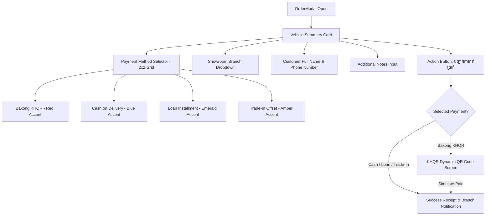

# VehicleHub Checkout & Reserve Vehicle Architecture Specification

> **Feature Version:** 2.0  
> **Target Endpoint / Modal:** `Checkout & Reserve Vehicle` (`OrderModal.tsx`)  
> **Schema Identifier:** `checkout_and_reserve`  
> **Language Support:** Khmer (primary) & English (subtitles)  

---

## 1. Overview & Data Schema

The **Checkout & Reserve Vehicle** component provides a streamlined 1-click modal for customers to reserve or purchase vehicles directly from the showroom grid, configurator, or vehicle detail view.

### Standardized JSON Specification (`checkout_and_reserve`)

```json
{
  "checkout_and_reserve": {
    "title_km": "កក់ទុក ឬទិញយានយន្តរបស់ប្រកបដោយភាពងាយស្រួល",
    "title_en": "Checkout & Reserve Vehicle",
    "vehicle_summary": {
      "image_url": "https://example.com/images/toyota-4runner-2026.png",
      "brand": "Toyota",
      "year": 2026,
      "model_name": "Toyota 4Runner i-FORCE MAX",
      "sku_or_vin": "TYT-4RNMAX-2026-02",
      "price": {
        "amount": 53490,
        "currency": "USD",
        "formatted_price": "$53,490"
      }
    },
    "payment_methods": [
      {
        "id": "bakong_khqr",
        "title_km": "Bakong KHQR",
        "subtitle_km": "វេទូទាត់តាម App ធនាគារនានា",
        "icon": "khqr_icon",
        "is_selected": true
      },
      {
        "id": "cash_on_delivery",
        "title_km": "សាច់ប្រាក់ / ផ្ទេរផ្ទាល់",
        "subtitle_km": "ទូទាត់នៅសាខាផ្ទាល់ពេលទទួលបានយានយន្ត",
        "icon": "cash_icon",
        "is_selected": false
      },
      {
        "id": "loan",
        "title_km": "បង់រំលស់ (Loan)",
        "subtitle_km": "បង់ប្រាក់កក់មុន រំលស់ ១២-៧២ ខែ",
        "icon": "loan_icon",
        "is_selected": false
      },
      {
        "id": "trade_in",
        "title_km": "ប្តូរឡានចាស់ (Trade-in)",
        "subtitle_km": "កាត់កាត់តម្លៃយានយន្តចាស់",
        "icon": "tradein_icon",
        "is_selected": false
      }
    ],
    "showroom_branches": [
      {
        "id": "branch_001",
        "name_km": "Phnom Penh Main Showroom (HQ) (Phnom Penh)",
        "name_en": "Phnom Penh Main Showroom (HQ) (Phnom Penh)",
        "is_selected": true
      },
      {
        "id": "branch_002",
        "name_km": "Siem Reap Heritage Showroom (Siem Reap)",
        "name_en": "Siem Reap Heritage Showroom (Siem Reap)",
        "is_selected": false
      },
      {
        "id": "branch_003",
        "name_km": "Battambang Regional Showroom (Battambang)",
        "name_en": "Battambang Regional Showroom (Battambang)",
        "is_selected": false
      }
    ],
    "customer_information": {
      "full_name": {
        "label_km": "ឈ្មោះអតិថិជន",
        "placeholder": "ឈ្មោះរបស់អតិថិជន",
        "required": true
      },
      "phone_number": {
        "label_km": "លេខទូរស័ព្ទ",
        "placeholder": "+855 12 345 678",
        "required": true
      }
    },
    "additional_notes": {
      "label_km": "ចំណាំបន្ថែម (Notes)",
      "placeholder": "ឧ. ស្នើសុំជួយសម្រួលធ្វើស្លាកលេខជូនខ្ញុំ...",
      "required": false
    },
    "action_button": {
      "text_km": "បញ្ជាក់ការកក់ប្រាក់ ($53,490)",
      "text_en": "Confirm Reservation ($53,490)",
      "action_type": "SUBMIT_RESERVATION"
    }
  }
}
```

---

## 2. Visual Component Architecture



---

## 3. UI Elements Breakdown

| UI Section | Element Key | Display Label (KM) | Purpose & Validation |
| :--- | :--- | :--- | :--- |
| **Header** | `title_en` | Checkout & Reserve Vehicle | Main modal title |
| **Subtitle** | `title_km` | កក់ទុក ឬទិញយានយន្តរបស់ប្រកបដោយភាពងាយស្រួល | Friendly Khmer subtitle |
| **Vehicle Card** | `vehicle_summary` | Brand, Year, Model, SKU, តម្លៃ | Clear vehicle recap before paying |
| **Payment 1** | `bakong_khqr` | Bakong KHQR (`វេទូទាត់តាម App ធនាគារនានា`) | Instant NBC KHQR Code generation |
| **Payment 2** | `cash_on_delivery` | សាច់ប្រាក់ / ផ្ទេរផ្ទាល់ (`ទូទាត់នៅសាខាផ្ទាល់ពេលទទួលបានយានយន្ត`) | Reserve vehicle without upfront payment |
| **Payment 3** | `loan` | បង់រំលស់ (Loan) (`បង់ប្រាក់កក់មុន រំលស់ ១២-៧២ ខែ`) | Connect to financing pipeline |
| **Payment 4** | `trade_in` | ប្តូរឡានចាស់ (Trade-in) (`កាត់កាត់តម្លៃយានយន្តចាស់`) | Trade-in offset appraisal valuation |
| **Branch** | `showroom_branches` | សាខាដែលត្រូវទទួលយានយន្ត (Showroom Branch) | Choose pickup / inspection dealership |
| **Customer Name** | `full_name` | ឈ្មោះអតិថិជន | Required text input |
| **Phone** | `phone_number` | លេខទូរស័ព្ទ | Required Cambodian phone number (+855...) |
| **Notes** | `additional_notes` | ចំណាំបន្ថែម (Notes) | Special requests (license plates, delivery date) |
| **Button** | `action_button` | បញ្ជាក់ការកក់ប្រាក់ ($53,490) | Submit reservation trigger |

---

## 4. Deliverables & Associated Files

- **Live Component:** [`frontend/components/OrderModal.tsx`](file:///d:/Project/vehicle-commerce/frontend/components/OrderModal.tsx)
- **JSON Specification:** [`frontend/public/checkout-and-reserve.json`](file:///d:/Project/vehicle-commerce/frontend/public/checkout-and-reserve.json)
- **Architecture Documentation:** [`docs/CHECKOUT_RESERVE_SPEC.md`](file:///d:/Project/vehicle-commerce/docs/CHECKOUT_RESERVE_SPEC.md)
