# 🗺️ VehicleHub Platform Information Architecture (Sitemap)

ឯកសារនេះបង្ហាញអំពីរចនាសម្ព័ន្ធ **Information Architecture (Sitemap Tree)** នៃគេហទំព័រ **VehicleHub Automotive Platform** ទាំងមូល ស្របតាមទម្រង់ Diagram មែកធាងដើមឈើ (Tree Hierarchy)។

---

## 📊 Sitemap Tree Diagram (Mermaid)

```mermaid
graph TD
    %% Styling Classes
    classDef rootStyle fill:#f97316,stroke:#ea580c,stroke-width:3px,color:#ffffff,font-weight:bold,rx:12px,ry:12px;
    classDef pillarStyle fill:#fb923c,stroke:#f97316,stroke-width:2px,color:#ffffff,font-weight:bold,rx:10px,ry:10px;
    classDef leafStyle fill:#ffffff,stroke:#fdba74,stroke-width:1.5px,color:#1e293b,rx:8px,ry:8px;

    %% Root
    ROOT["Information Architecture<br/>VehicleHub Automotive Platform"]:::rootStyle

    %% Pillars
    P1["Home / Showroom"]:::pillarStyle
    P2["Categories & Lineup"]:::pillarStyle
    P3["Interactive Tools"]:::pillarStyle
    P4["Showrooms & Branches"]:::pillarStyle
    P5["AI Advisor & Support"]:::pillarStyle
    P6["Financing & Checkout"]:::pillarStyle

    ROOT --> P1
    ROOT --> P2
    ROOT --> P3
    ROOT --> P4
    ROOT --> P5
    ROOT --> P6

    %% Sub-nodes under Home
    P1 --> H1["Hero 3D Stage Carousel"]:::leafStyle
    P1 --> H2["Search Bar & Shortcut (Ctrl+K)"]:::leafStyle
    P1 --> H3["Top Brand Selector (Toyota, BMW...)"]:::leafStyle
    P1 --> H4["Multi-Criteria Vehicle Filters"]:::leafStyle
    P1 --> H5["Vehicle Inventory Grid (44+ Models)"]:::leafStyle
    P1 --> H6["Quick Spec Modal (Specs & Price)"]:::leafStyle
    P1 --> H7["Promotional Banners & Deals"]:::leafStyle
    P1 --> H8["Footer Directory & Navigation"]:::leafStyle

    %% Sub-nodes under Categories & Lineup
    P2 --> C1["Electric & Hybrid (EVs)"]:::leafStyle
    P2 --> C2["Gasoline SUVs & Trucks"]:::leafStyle
    P2 --> C3["Official Toyota Lineup (27 Models)"]:::leafStyle
    P2 --> C4["Bicycles & E-Bikes"]:::leafStyle
    P2 --> C5["Genuine Spare Parts & Kits"]:::leafStyle
    P2 --> C6["Model Specs & Trims"]:::leafStyle
    P2 --> C7["Color Swatches & Galleries"]:::leafStyle

    %% Sub-nodes under Interactive Tools
    P3 --> T1["360° Configurator Studio"]:::leafStyle
    P3 --> T2["6 Camera Angles (360° Exterior & Cockpit)"]:::leafStyle
    P3 --> T3["Wheel Rims & Brake Calipers"]:::leafStyle
    P3 --> T4["Loan & Installment Calculator"]:::leafStyle
    P3 --> T5["Trade-In Valuation Appraisal"]:::leafStyle
    P3 --> T6["Complimentary Test Drive Booking"]:::leafStyle
    P3 --> T7["Visual Sitemap Directory (/sitemap)"]:::leafStyle

    %% Sub-nodes under Showrooms & Branches
    P4 --> B1["Phnom Penh Main Flagship (HQ)"]:::leafStyle
    P4 --> B2["Siem Reap Heritage Showroom"]:::leafStyle
    P4 --> B3["Battambang Regional Branch"]:::leafStyle
    P4 --> B4["Multi-Branch Real-Time Stock"]:::leafStyle
    P4 --> B5["Showroom Operating Hours & Contacts"]:::leafStyle
    P4 --> B6["Branch Test Drive Fleet Allocation"]:::leafStyle

    %% Sub-nodes under AI Advisor & Support
    P5 --> A1["AI Sales Consultant (វិបុល / Vibol)"]:::leafStyle
    P5 --> A2["Khmer Natural Language Reasoning"]:::leafStyle
    P5 --> A3["Passenger & Family Size Advisor (5 vs 7)"]:::leafStyle
    P5 --> A4["Color & Style Matching Engine"]:::leafStyle
    P5 --> A5["Telegram Concierge Live Support"]:::leafStyle
    P5 --> A6["Official XML Sitemap (/sitemap.xml)"]:::leafStyle
    P5 --> A7["Robots Policy (/robots.txt)"]:::leafStyle

    %% Sub-nodes under Financing & Checkout
    P6 --> F1["Instant Bakong KHQR Payment (USD & KHR)"]:::leafStyle
    P6 --> F2["Order Confirmation Modal"]:::leafStyle
    P6 --> F3["Installment Term Selection (12-72 Mo)"]:::leafStyle
    P6 --> F4["Down Payment Adjuster (10% - 50%)"]:::leafStyle
    P6 --> F5["Trade-In Equity Offset"]:::leafStyle
    P6 --> F6["Admin ERP Multi-Branch Inventory"]:::leafStyle
```

---

## 🏛️ រចនាសម្ព័ន្ធលម្អិតនៃ Pillar នីមួយៗ (Detailed Structure Breakdown)

| Pillar | ឈ្មោះផ្នែកជាភាសាខ្មែរ | សមាសភាគ & មុខងារសំខាន់ៗ | តំណភ្ជាប់ / Modal |
| :--- | :--- | :--- | :--- |
| **1. Home / Showroom** | ទំព័រដើម & តាំងបង្ហាញ | • Hero 3D Stage Carousel • Brand Selector (Toyota, BMW, Lexus...) • Search Bar (Ctrl+K) • Vehicle Grid 44+ គ្រឿង • Promotional Deals | `/` |
| **2. Categories & Lineup** | កាតាឡុក & ប្រភេទរថយន្ត | • Electric & Hybrid (EV) • Gasoline SUVs & Trucks • Toyota 2026-2027 Lineup • Bicycles & E-Bikes • Genuine Spare Parts | `/?category=...` |
| **3. Interactive Tools** | ឧបករណ៍ឌីជីថលឆ្លាតវៃ | • **360° Studio Configurator** (៦ ជ្រុង + ពណ៌ + កង់) • **Loan Calculator** (បង់រំលស់ 12 - 72 ខែ) • **Trade-In Modal** (វាយប្តូរឡានចាស់) • **Test Drive Booking** (កក់បើកបរសាកល្បង) | `/#color-studio-360` `/#loan-calculator` `/#trade-in` |
| **4. Showrooms & Branches** | សាខា Showroom ទូទាំងប្រទេស | • Phnom Penh Main Showroom (HQ) • Siem Reap Heritage Branch • Battambang Regional Branch • ពិនិត្យស្តុកតាមសាខាជាក់ស្តែង | `/?branch=...` |
| **5. AI Advisor & Support** | ជំនួយការ AI & សេវាកម្ម | • **ទីប្រឹក្សា AI វិបុល (Vibol)** ឆ្លើយតបជាភាសាខ្មែរ • ណែនាំតាមទំហំគ្រួសារ ពណ៌ និងថវិកា • Telegram Concierge Channel • XML Sitemap & Robots.txt | `/#ai-consultant-vibol` `/sitemap.xml` `/robots.txt` |
| **6. Financing & Checkout** | ការបង់ប្រាក់ & គ្រប់គ្រងការបញ្ជាទិញ | • ទូទាត់រហ័សតាម Bakong KHQR • គណនាកម្ចី និងប្រាក់បង់ប្រចាំខែ (8.5% APR) • កាត់ប្រាក់ពីឡានចាស់ (Trade-in Equity) • Admin ERP Multi-Branch Dashboard | `/admin` Order Modal |

---

## 🔗 តំណភ្ជាប់បច្ចេកទេស (Technical Routes)
- **Visual Diagram Webpage:** [http://localhost:3000/sitemap-diagram](http://localhost:3000/sitemap-diagram)
- **Visual Directory Sitemap:** [http://localhost:3000/sitemap](http://localhost:3000/sitemap)
- **Raw XML Sitemap (SEO):** [http://localhost:3000/sitemap.xml](http://localhost:3000/sitemap.xml)
- **Crawler Rules:** [http://localhost:3000/robots.txt](http://localhost:3000/robots.txt)
- **Standalone HTML File:** `sitemap-diagram.html` (បើកក្នុង Browser ណាផ្សេងក៏បាន)
